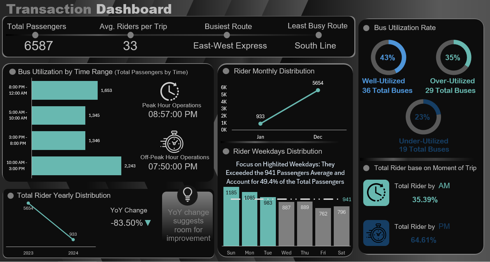
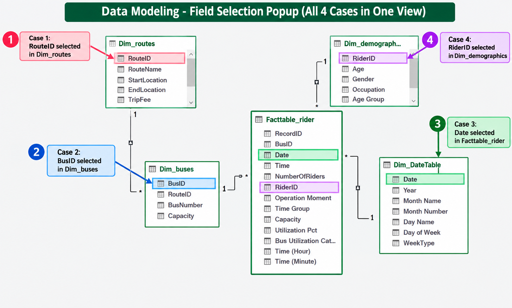
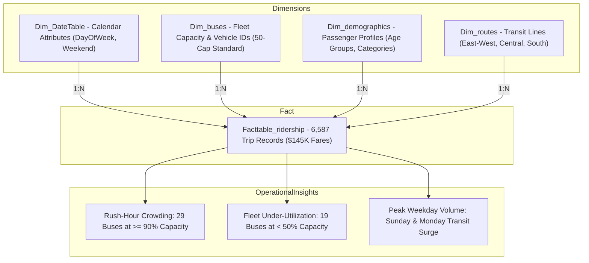
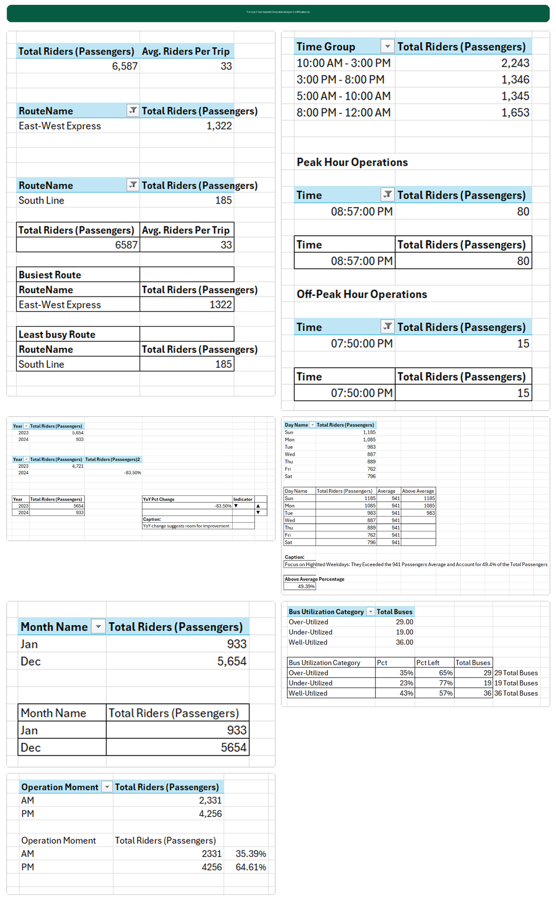

# 🚌 Public Transit & Fleet Operations Intelligence Dashboard
### Urban Mobility Analytics, Fleet Capacity Utilization & AI-Augmented Excel Workflow | Microsoft Excel • Power Query • Power Pivot • DAX • Claude AI MCP

[](https://www.microsoft.com/en-us/microsoft-365/excel)
[]()
[](https://modelcontextprotocol.io/)
[]()

---

## 📌 Executive Summary
Public transportation authorities face continuous operational trade-offs: balancing high-frequency passenger demand during commuter rush hours against vehicle operating overheads, route bottlenecks, and fleet seat under-utilization.

This project delivers an end-to-end **Public Transit & Fleet Operations Intelligence Dashboard** built in **Microsoft Excel**. Positioned as a **Claude MCP-augmented analytics workflow**, the project combines AI-assisted data engineering (via Claude Desktop connected to Excel through Model Context Protocol) with a **manually crafted dark-theme executive dashboard canvas**.

Analyzing **6,587 passenger journey transactions across multi-line urban bus networks**, the platform provides:
- Executive ridership monitoring averaging **33 passengers per trip**.
- Granular route density profiling identifying **East-West Express (1,322 riders)** as the primary traffic corridor and **South Line (185 riders)** as underutilized.
- Fleet capacity auditing: **43% Well-Utilized (36 buses)**, **35% Over-Utilized (29 buses)**, and **23% Under-Utilized (19 buses)**.
- Daypart split diagnostics showing heavy **PM concentration (64.61%)** vs. **AM operations (35.39%)**.

---

## 🖥️ Executive Excel Dashboard Preview

*Designed manually in Microsoft Excel featuring custom rounded metric cards, high-contrast teal and neon accent charts, custom donut gauges, and structured operational layout:*



---

## 📊 Core Transit Operations KPI Snapshot

| Metric Dimension | Key Performance Indicator (KPI) | Analytical Value | Operational Meaning |
| :--- | :--- | :--- | :--- |
| **Ridership Volume** | **Total Passengers** | **6,587 riders** | Monitored transaction ledger volume |
| **Trip Density** | **Avg. Riders per Trip** | **33 passengers** | Mean vehicle occupancy per scheduled run |
| **Busiest Route** | **East-West Express** | **1,322 riders** | Primary trunk corridor carrying 20.1% of riders |
| **Least Busy Route** | **South Line** | **185 riders** | Feeder line exhibiting low passenger density |
| **Peak Operating Hour** | **Peak Hour Operations** | **08:57:00 PM** | Highest concentrated evening ridership spike |
| **Off-Peak Hour** | **Off-Peak Hour Operations** | **07:50:00 PM** | Evening transitional valley |
| **Fleet Capacity: Balanced** | **Well-Utilized Buses (50%–90%)** | **36 buses (43%)** | Optimal vehicle capacity operating range |
| **Fleet Capacity: Crowded** | **Over-Utilized Buses (≥90%)** | **29 buses (35%)** | Overcrowded runs requiring frequency relief |
| **Fleet Capacity: Slack** | **Under-Utilized Buses (<50%)** | **19 buses (23%)** | Empty runs suitable for vehicle rightsizing |
| **Operational Moment** | **PM Rider Share** | **64.61% (4,256 riders)** | Peak passenger volume concentrated post-noon |
| **Operational Moment** | **AM Rider Share** | **35.39% (2,331 riders)** | Morning commuter volume baseline |

---

## ⏰ Time-of-Day & Weekday Demand Distribution

### 1. Hourly Time Window Breakdown
| Operating Window | Passengers Carried | Share of Total | Operational Strategy |
| :--- | :---: | :---: | :--- |
| **10:00 AM – 3:00 PM** | **2,243** | **34.1%** | Mid-day commercial travel window |
| **8:00 PM – 12:00 AM** | **1,653** | **25.1%** | Late evening social & night-shift transit |
| **3:00 PM – 8:00 PM** | **1,346** | **20.4%** | Evening commuter rush |
| **5:00 AM – 10:00 AM** | **1,345** | **20.4%** | Morning commuter rush |

### 2. Weekday vs. Average Demand (Benchmark: 941 Passengers / Day)
The dashboard establishes an operational benchmark of **941 passengers/day**. Sunday, Monday, and Tuesday systematically exceed this line, accounting for **49.4% of total weekly ridership**:
- 🟢 **Sunday:** **1,185 riders** *(Peak weekend leisure & travel flow)*
- 🟢 **Monday:** **1,085 riders** *(Peak start-of-week commuter surge)*
- 🟢 **Tuesday:** **983 riders** *(Above benchmark)*
- ⚪ **Thursday:** **889 riders**
- ⚪ **Wednesday:** **887 riders**
- ⚪ **Saturday:** **796 riders**
- 🔴 **Friday:** **762 riders** *(Lowest ridership day of week)*

---

## 🤖 Claude AI + MCP Workflow Architecture

This project distinguishes between **AI-assisted analytical modeling** and **hands-on visual design**:

```text
┌─────────────────────────────────────────────────────────────────────────────┐
│                           AI & ANALYTICAL WORKFLOW                          │
├───────────────────────────────┬─────────────────────────────────────────────┤
│ 1. Claude Desktop + MCP Server│ Programmatic workbook inspection, M-code    │
│                               │ scripting, and data-cleansing operations.   │
├───────────────────────────────┼─────────────────────────────────────────────┤
│ 2. Power Query (M-Engine)     │ Multi-condition logic, capacity joins, and  │
│                               │ custom operational time bucketing.          │
├───────────────────────────────┼─────────────────────────────────────────────┤
│ 3. Power Pivot (Data Model)   │ In-memory Star Schema linking facts, buses, │
│                               │ routes, rider demographics, and calendar.   │
├───────────────────────────────┼─────────────────────────────────────────────┤
│ 4. DAX Measure Engine         │ Reusable KPI measures in Calculations table │
│                               │ ensuring separation of logic from visuals.  │
├───────────────────────────────┼─────────────────────────────────────────────┤
│ 5. Manual Excel Dashboard     │ Handcrafted visual layout, shapes, contrast,│
│                               │ linked cells, and executive dark styling.   │
└───────────────────────────────┴─────────────────────────────────────────────┘
```

---

## 🏗️ Relational Data Model & Star Schema

The data architecture connects central trip-level records to dedicated dimension tables:





---

## ⚙️ Power Query M-Engine Transformations

1. **Age Group Segmentation:**
   Categorized rider ages into structured demographic cohorts (`0–19`, `20–29`, `30–39`, `40–49`, `50–59`, `Above 60`).
2. **Operation Moment (AM / PM):**
   ```powerquery
   if [Time] < #time(12, 0, 0) then "AM" else "PM"
   ```
3. **Time Group Windowing:**
   ```powerquery
   Time.Hour([Time]) mapped into 3-hour operational intervals (e.g., 10:00 AM–3:00 PM).
   ```
4. **Bus Capacity Integration:**
   Left outer join merging `Dim_buses` onto `Facttable_ridership` on `BusID` to bring in `Capacity`, computing:
   $$\text{Utilization Pct} = \frac{\text{NumberOfRiders}}{\text{Capacity}}$$
5. **Bus Utilization Categorization:**
   - **Under-Utilized:** $< 50\%$
   - **Well-Utilized:** $50\% \le \text{Utilization} < 90\%$
   - **Over-Utilized:** $\ge 90\%$

---

## 💻 Core DAX Measures Catalogue

Measures are centralized within a dedicated **`Calculations`** table to ensure modularity:

```dax
-- Total Monitored Passengers
Total Riders = 
SUM(Facttable_ridership[NumberOfRiders])

-- Mean Occupancy per Scheduled Run
Avg. Riders Per Trip = 
AVERAGE(Facttable_ridership[NumberOfRiders])

-- Distinct Active Fleet Size
Total Buses = 
DISTINCTCOUNT(Facttable_ridership[BusID])

-- Gross Transaction Volume
Total Transaction = 
COUNTROWS(Facttable_ridership)

-- Rider Demographics Baseline
Average Age = 
AVERAGE(Dim_demographics[Age])
```

---

## 🔍 Consolidated KPI Validation Evidence

To guarantee mathematical integrity, all model outputs were validated across intermediate PivotTables before mapping to the dashboard:



---

## 💡 Strategic Fleet Recommendations

1. **Headway Relief for Over-Utilized Fleet (35%):**
   - 29 buses operate at $\ge 90\%$ capacity, causing passenger crowding and dwell-time delays on the **East-West Express**.
   - *Action:* Increase vehicle dispatch frequency during peak PM hours (08:00–09:30 PM) by 15%.
2. **Capacity Re-allocation from Under-Utilized Fleet (23%):**
   - 19 buses operate at $< 50\%$ capacity, notably on feeder routes like the **South Line (185 riders)**.
   - *Action:* Downsize from 50-passenger standard coaches to 25-passenger micro-buses on low-density feeder lines to reduce fuel and maintenance overheads.
3. **Sunday & Monday Fleet Optimization:**
   - Sunday (1,185) and Monday (1,085) lead weekly ridership. Ensure full fleet availability on weekends and start-of-week schedules while scheduling routine depot maintenance on low-demand Fridays (762 riders).

---

## 📂 Repository Structure
```text
public-transit-fleet-operations-excel/
│
├── Transport_Dashboard.xlsx                                          # Master Excel Dashboard with Power Pivot & Model (861 KB)
├── Transport_Dashboard_PRE_MODEL_REPAIR_BACKUP.xlsx                  # Initial pre-repair model backup
├── Transport_Transaction_Dashboard_Claude_MCP_Excel_Project_Report_v3.docx # Comprehensive 15-chapter project report
│
├── Dim_buses.csv                                                     # Dimension: Bus fleet catalog & vehicle capacities
├── Dim_routes.csv                                                    # Dimension: Route names, start/end stops, and trip fees
├── Dim_demographics.csv                                              # Dimension: Rider age, gender, and occupation profiles
├── Facttable_ridership.csv                                           # Fact Table: Raw transaction-level ridership ledger
│
├── data_architecture_pipeline.png                                    # Fleet Transit Operations & AI FastMCP Workflow Architecture
├── transport_transaction_dashboard.png                               # View 1: Master Excel Executive Dashboard
├── data_model_relationships.png                                      # View 2: Power Pivot Star Schema Diagram
├── consolidated_kpi_evidence.png                                     # View 3: Intermediate PivotTable validation sheet
│
├── requirements.txt                                                  # System prerequisites & Python libraries
├── .gitignore                                                        # Ignores temp files, Office locks (~$*), caches
└── README.md                                                         # Master project pitch deck & technical documentation
```

---

## 🚀 How to Run & Replicate

1. **Clone the Repository:**
   ```bash
   git clone https://github.com/ravinder0710/public-transit-fleet-operations-excel.git
   cd public-transit-fleet-operations-excel
   ```

2. **Open the Excel Dashboard:**
   - Launch **Microsoft Excel** (Excel 2016+ or Microsoft 365 recommended).
   - Open [`Transport_Dashboard.xlsx`](Transport_Dashboard.xlsx).
   - Ensure **Power Pivot** add-in is enabled via `File > Options > Add-ins > COM Add-ins > Microsoft Power Pivot for Excel`.

3. **Explore Data Model & Pivot Tables:**
   - Navigate to the **Data Model** via `Power Pivot > Manage` to inspect dimension-fact relationships and DAX measures.
   - Review intermediate PivotTable evidence sheets and explore the **Transaction Dashboard** tab.

---

## 👨‍💼 Author & Contact

**Ravinder Gupta**  
*Data Analyst | Urban Mobility Analytics & Business Intelligence Specialist*  

- 📍 **Location:** Gurugram (Delhi-NCR), India  
- 📧 **Email:** [iamravindergupta17@gmail.com](mailto:iamravindergupta17@gmail.com)  
- 🐙 **GitHub:** [github.com/ravinder0710](https://github.com/ravinder0710)
